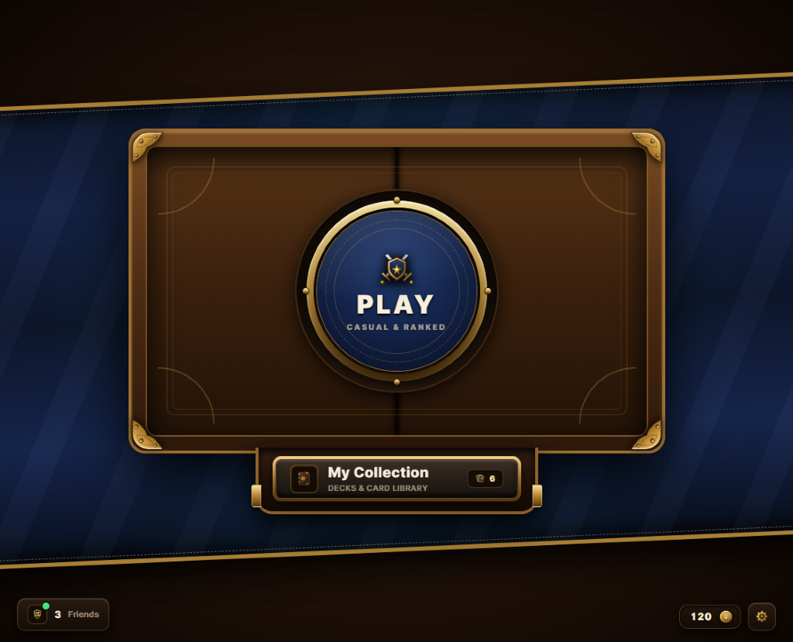

# Hearthlight ⚔️

> A tactile, fast, and handcrafted 1v1 digital card game (CCG) client and engine built with **React 19**, **TypeScript**, and **Tailwind CSS v4**.



Hearthlight recreates the warm, weighted charm of classic tavern tabletop card games (inspired by *Hearthstone*) in the browser—with instantaneous loading, smooth 60fps animations, and zero heavy 3D engines or external texture downloads.

---

## ⚡ Highlights

- **Pure TypeScript Engine:** Card mechanics, turn cycles, keywords (*Divine Shield*, *Taunt*, *Rush*), and battlecries are decoupled from UI logic in `src/engine/`.
- **Handcrafted Tabletop UI:** Dark walnut wood cabinetry, brushed brass joinery, draped royal-navy velvet runner, and deep enamel medallions rendered with pure CSS and lightweight inline SVGs (< 5 KB added footprint).
- **Zero Asset Bloat:** Instant initial load with zero external raster images, 3D canvases, or WebGL dependencies.
- **Fluid Micro-Interactions:** Subtle 3D mouse parallax, spring-physics button detents, and smooth drawer transitions powered by `motion`.
- **Interactive Lobby & HUD:** Live deck/card collection viewer, online friends list with duel triggers, tavern gold balance, and audio/graphics options modal.

---

## 🛠️ Tech Stack

- **UI Framework:** [React 19](https://react.dev/)
- **Language:** [TypeScript](https://www.typescriptlang.org/)
- **Bundler:** [Vite 8](https://vite.dev/)
- **Styling:** [Tailwind CSS v4](https://tailwindcss.com/) via `@tailwindcss/vite`
- **Animation:** [Motion](https://motion.dev/)
- **State Management:** [Zustand 5](https://zustand-demo.pmnd.rs/)
- **Icons:** Custom-crafted inline SVG icon system

---

## 🚀 Quick Start

Run Hearthlight locally in less than a minute:

```bash
# Clone the repository
git clone https://github.com/officialsinasinaei/Hearthlight.git

# Enter project directory
cd Hearthlight

# Install dependencies
npm install

# Start local dev server
npm run dev
```

Open [http://localhost:5173](http://localhost:5173) in your browser.

### Production Build

```bash
npm run build
npm run preview
```

---

## 📂 Project Structure

```text
src/
├── engine/              # Pure TypeScript game rules, card definitions, and state transitions
│   ├── types.ts         # Card, hero, event, and action domain models
│   └── cards.ts         # Starter card library and keyword definitions
├── store/               # Global Zustand state stores (navigation, settings, gold)
│   └── useAppStore.ts   # Screen router, social list, and user settings
├── components/
│   └── menu/            # Tabletop main menu ("The Box") & custom inline SVGs
│       ├── MainMenuScreen.tsx
│       ├── CenterPlayMedallion.tsx
│       ├── CollectionTrayButton.tsx
│       ├── BottomHudBar.tsx
│       ├── FriendsDrawer.tsx
│       ├── SettingsModal.tsx
│       └── MenuIcons.tsx
├── utils/               # Tailwind merge and classname helpers
├── App.tsx              # Root screen orchestrator (Menu, Collection, Match Arena)
└── index.css            # Tailwind v4 theme tokens and 3D utility classes
```

---

## 📄 License

MIT © [Sina Sinaei](https://github.com/officialsinasinaei)
