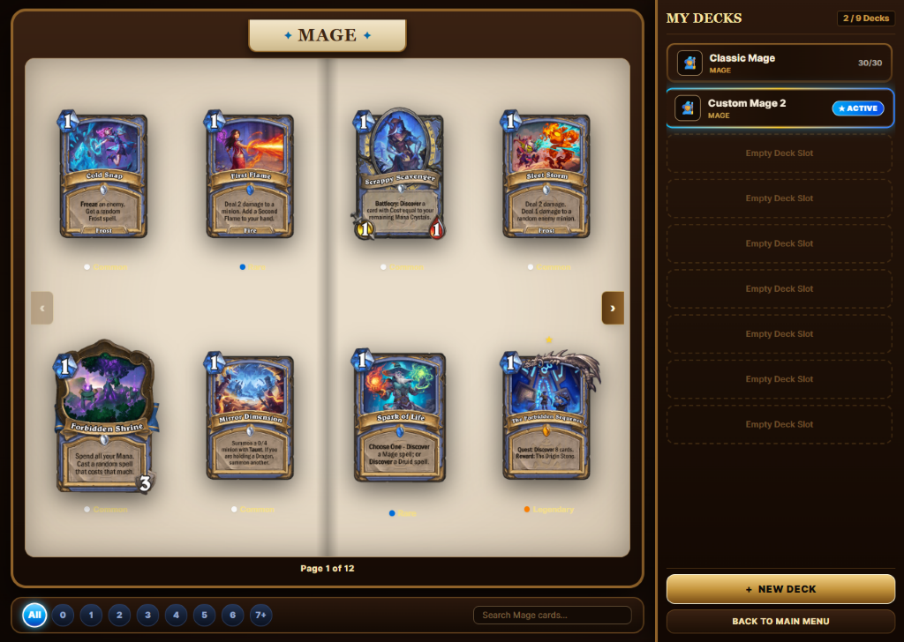

# Hearthlight ⚔️

> A tactile, fast, and handcrafted 1v1 digital card game (CCG) client and engine built with **React 19**, **TypeScript**, and **Tailwind CSS v4**.




Hearthlight recreates the warm, weighted charm of classic tavern tabletop card games (inspired by *Hearthstone*) in the browser—with instantaneous loading, smooth 60fps animations, and zero heavy 3D engines or external texture downloads.

---

## ⚡ Highlights

- **Pure TypeScript Engine:** Card mechanics, turn cycles, keywords (*Divine Shield*, *Taunt*, *Rush*), and battlecries are decoupled from UI logic in `src/engine/`.
- **Full Standard Mage Collection:** Ingested all 96 official Blizzard Standard Mage cards with full stats, spell schools, and flavor text. Zero Neutral cards for pure class focus.
- **Tome-Style Book Pagination:** 8-card virtualized two-page spread (`Page X of 12`), interactive mana curve filter tray (`All`, `0`–`7+`), and live search bar.
- **3D Card Inspection:** Click any card to inspect an enlarged 3D tilt render with flavor text and one-click deck building buttons.
- **Hero Selection ("Choose Your Hero"):** 3x3 class grid with Jaina Proudmoore ready to play, other 8 classes labeled *Coming Soon*, right pedestal with Jaina and 2-mana Fireblast power.
- **Strategic Deck Builder:** 30 cards per deck, max 2 copies (1 for Legendary), mana-sorted deck sidebar, auto-curve completion, and illuminated active deck system.
- **Handcrafted Tabletop UI:** Dark walnut wood cabinetry, brushed brass joinery, draped royal-navy velvet runner, and deep enamel medallions rendered with pure CSS and lightweight inline SVGs.
- **Interactive Lobby & HUD:** Live deck/card collection viewer, online friends list with duel triggers, tavern gold balance, and audio/graphics options modal.

---

## 🛠️ Tech Stack

- **UI Framework:** [React 19](https://react.dev/)
- **Language:** [TypeScript](https://www.typescriptlang.org/)
- **Bundler:** [Vite 8](https://vite.dev/)
- **Styling:** [Tailwind CSS v4](https://tailwindcss.com/) via `@tailwindcss/vite`
- **Animation:** [Motion](https://motion.dev/)
- **State Management:** [Zustand 5](https://zustand-demo.pmnd.rs/) with `localStorage` persistence
- **Icons:** Custom-crafted inline SVG icon system

---

## 🚀 Quick Start

Run Hearthlight locally in less than a minute:

```bash
# Clone the repository
git clone https://github.com/officialsinasinaei/Hearthlight.git

# Enter project directory
cd Hearthlight

# Install dependencies
npm install

# Start local dev server
npm run dev
```

Open [http://localhost:5173](http://localhost:5173) in your browser.

### Production Build

```bash
npm run build
npm run preview
```

---

## 📂 Project Structure

```text
src/
├── engine/              # Pure TypeScript game rules, card definitions, and state transitions
│   ├── types.ts         # Card, hero, saved deck, and event domain models
│   ├── cards.ts         # Starter deck generator and curve auto-completion
│   └── mage-cards.json  # 96 Standard Mage card dataset with Blizzard CDN assets
├── store/               # Global Zustand state stores
│   ├── useAppStore.ts        # Screen router, social list, and user settings
│   └── useCollectionStore.ts # Decks, active deck, copy limits, and search/filter state
├── components/
│   ├── menu/            # Tabletop main menu ("The Box") & custom inline SVGs
│   │   ├── MainMenuScreen.tsx
│   │   ├── CenterPlayMedallion.tsx
│   │   ├── CollectionTrayButton.tsx
│   │   ├── BottomHudBar.tsx
│   │   ├── FriendsDrawer.tsx
│   │   ├── SettingsModal.tsx
│   │   └── MenuIcons.tsx
│   └── collection/      # Hearthstone-fidelity My Collection screen
│       ├── CollectionScreen.tsx   # Root collection coordinator
│       ├── CollectionBookView.tsx # 8-card two-page tome & mana crystal tray
│       ├── CollectionSidebar.tsx  # Deck list & deck editor with active deck badge
│       ├── HearthstoneCard.tsx    # Card component with copy-limit plaques
│       ├── CardInspectModal.tsx   # 3D tilt inspect overlay with flavor text
│       └── HeroSelectView.tsx     # 3x3 hero selection & Jaina pedestal
├── utils/               # Tailwind merge and classname helpers
├── App.tsx              # Root screen orchestrator (Menu, Collection, Match Arena)
└── index.css            # Tailwind v4 theme tokens and 3D utility classes
```

---

## 📄 License

MIT © [Sina Sinaei](https://github.com/officialsinasinaei)
